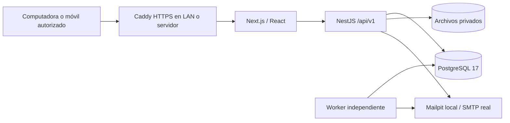

# Arquitectura

Las conexiones del adaptador PostgreSQL usan `timezone=UTC` explícitamente. Los instantes se validan como ISO con desplazamiento y se muestran en `America/Costa_Rica`; las fechas clínicas se almacenan como DATE. La prueba de integración compara la fecha/hora guardada directamente en SQL para detectar desplazamientos.

## Componentes

En desarrollo `localhost:3000` entra directamente a Next. El proxy de Next reenvía `/api/*` al backend, por lo que el navegador utiliza un solo origen. La base de datos, el worker y los archivos no tienen URLs públicas. Las operaciones de negocio se ejecutan en el servidor; el menú no sustituye la autorización.

`apps/api` contiene el servicio Nest y la entrada independiente del worker; ambos comparten Prisma y las mismas reglas. Evita crear un paquete `apps/worker` con lógica duplicada. `apps/web` contiene las pantallas, estilos, manifiesto y service worker. `assets/branding` conserva el logo maestro. Las migraciones están en `apps/api/prisma/migrations`. Las versiones efectivas se consultan en el lockfile; actualizar dependencias requiere repetir las verificaciones.

## Decisiones explícitas

**Cola PostgreSQL en lugar de Redis/BullMQ.** Los recordatorios se guardan en `Reminder`, con clave única de deduplicación, estado, contador de intentos, fecha de ejecución y bloqueo recuperable. Un proceso independiente reclama trabajo de forma transaccional y escribe una notificación ligada de forma única al recordatorio. El motor persistente ya disponible reduce servicios para una PC privada. El reinicio del navegador no elimina tareas; el worker debe estar activo. El envío SMTP puede repetirse si el proveedor recibe el correo y la conexión falla antes de confirmar; no se promete entrega exactamente una vez a sistemas externos. Las pruebas del worker deben cubrir deduplicación y reintentos.

**Almacenamiento privado local por defecto.** Un directorio o volumen persistente guarda los bytes; PostgreSQL guarda nombre, MIME, tamaño, SHA-256, categoría y vínculo al perro. La API valida sesión y rol en cada descarga y no sirve el directorio como estático. Esta primera instalación usa volumen local para permitir puesta en marcha nativa y restauración verificable sin otro servicio. Existe adaptación S3 configurable en el backend; su despliegue/restore requieren validación adicional antes de adoptar MinIO. No hay MinIO obligatorio en Compose y los scripts entregados sólo cubren archivos locales. Es una desviación documentada del almacenamiento S3 preferido en el prompt, no una afirmación de equivalencia operacional completa.

**Ámbito único.** Todos los usuarios pertenecen a VALKYR. No hay empresas múltiples ni registro público. Los roles separan acciones; el entrenador sólo registra servicios contractuales de sus asignaciones. No hay aislamiento completo del expediente canino por municipalidad o custodio.

**Fechas.** Nacimiento y vacunas usan fechas civiles PostgreSQL `date`. Citas, auditoría y entrenamientos son instantes `timestamptz`; presentación `es-CR` / `America/Costa_Rica`. No sumar/restar horas a fechas civiles para representarlas.

## Persistencia e integridad

Identificadores UUID y código canino único. Microchip único cuando existe. Los expedientes/documentos se archivan lógicamente; las relaciones críticas restringen borrado. Los cuatro ejes de estado canino son independientes. Las reglas aplicadas al cambiar estado deben revisarse con los casos de negocio: no confundir retiro administrativo con disponibilidad o estado reproductivo.

Los volúmenes `postgres` y `files` sobreviven al reemplazo de contenedores. `compose.production.yaml` es independiente del archivo de desarrollo, para no heredar la publicación de PostgreSQL o Mailpit. El servicio `migrate` debe completar antes de iniciar API/worker. La aplicación no ejecuta automáticamente un bootstrap ni inserta ejemplos.

## Límites de esta arquitectura

Los módulos `contracts`, `breeding`, `finance` e `inventory` comparten PostgreSQL y auditoría. Las asignaciones usan bloqueos transaccionales por perro y contrato; apartados y pagos coordinan sus escrituras con el bloqueo comercial y los movimientos de inventario bloquean su lote. Los UUID de petición impiden duplicar un pago o movimiento al reintentar; reutilizarlos con otro contenido genera conflicto. Estos bloqueos privilegian integridad sobre concurrencia masiva en la instalación de una sola organización.

Los importes usan `Decimal(18,2)`, cantidades `Decimal(18,3)` y tipo de cambio referencial `Decimal(18,6)`. La API serializa decimales como cadenas. CRC y USD se totalizan por separado. Un cachorro y el perro promovido conservan el mismo UUID; el pedigrí y la camada enlazan esa identidad. Los adjuntos contractuales y financieros usan el almacenamiento privado con checksum. Los triggers rechazan cambios y borrados de auditoría, versiones contractuales, pagos y movimientos de inventario; un propietario de base todavía puede alterar esos triggers.

`ServiceHeartbeat` registra la última ejecución del trabajador. El monitor administrativo combina ese pulso con la cola y la disponibilidad de almacenamiento. No sustituye un supervisor externo capaz de avisar cuando el servidor entero se apaga.

La PC debe permanecer encendida para API, calendario y recordatorios. La instalación inicial es de una instancia, sin alta disponibilidad ni réplica. Los archivos y respaldos necesitan cifrado de disco del sistema operativo; no se declara cifrado automático del volumen. Restauraciones requieren preservar la clave de cifrado TOTP. Las mejoras operativas y módulos siguientes se detallan en [ROADMAP](ROADMAP.md).
