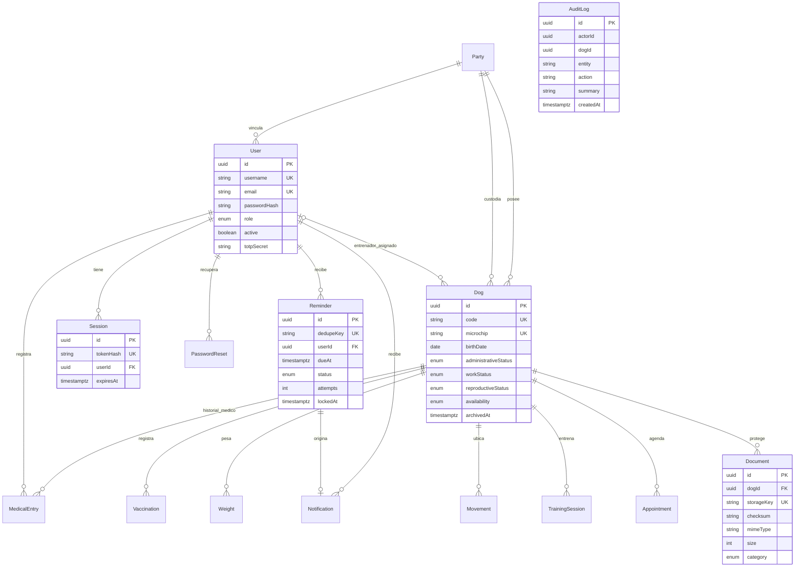
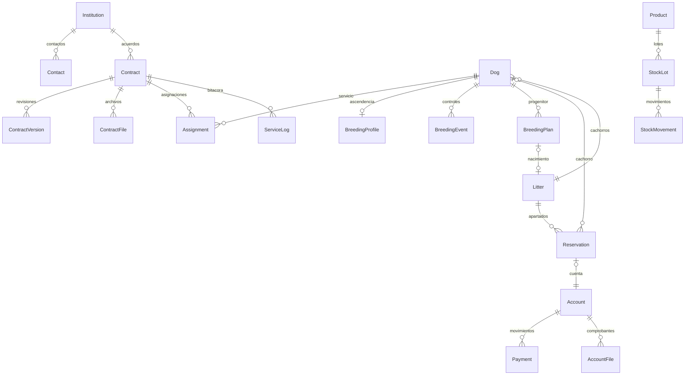

# Modelo de datos implementado

Fuente normativa: `apps/api/prisma/schema.prisma` y sus migraciones. El diagrama muestra relaciones relacionales principales; `actorId`/`recordedBy` conservan identidad histórica y no deben interpretarse como una autorización.

Los índices por perro/fecha permiten historiales; los de vencimiento y estado/fecha permiten reclamar recordatorios. La tabla `RateLimit` guarda límites de intentos persistentes. `AuditLog` mantiene trazabilidad independiente del ciclo de vida del actor/expediente; no hay endpoint de edición ni eliminación de auditoría.

`Dog.isPuppy` distingue el directorio de camadas del de la unidad; la incorporación conserva el mismo UUID. `BreedingProfile` referencia padres Dog y documenta procedencia. `Account` admite referencias a Dog/Litter/Contract; importes Decimal(18,2), cambio Decimal(18,6). Inventario usa Decimal(18,3). Pagos, movimientos de stock y versiones contractuales tienen triggers contra modificación/eliminación. Un índice parcial impide dos reservas activas/entregadas por cachorro. `ServiceHeartbeat` conserva la última actividad del trabajador sin datos personales.
